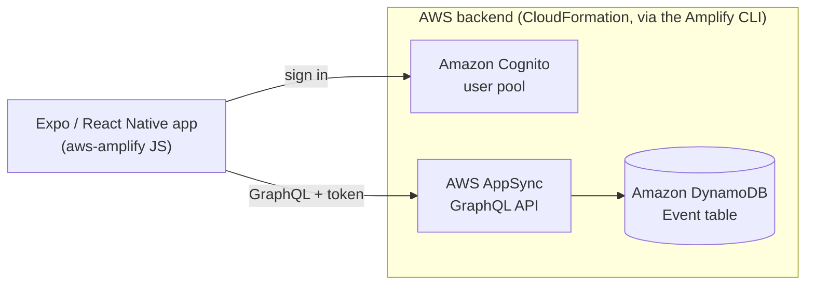

# LinkApp

A cross-platform mobile app for sharing and discovering local events. Users sign up, post an event with a description, address and date, and browse what others have posted. It's built with React Native and Expo on a serverless AWS backend: Amazon Cognito for sign-in and an AWS AppSync GraphQL API that stores events in DynamoDB, all provisioned through the AWS Amplify CLI.

> **Note:** This is a personal homelab project I built while learning React Native and AWS Amplify. It is not deployed or used in production anywhere.

---

## Features

- **Accounts.** Sign up, email verification, sign in and password reset through Amazon Cognito, using Amplify's authenticator with a custom dark theme and relabelled screens ("Log In", "Create Account").
- **Create events.** A form for the event name, description or rules, street address, city, state, zip code and date/time. Submitting it sends a GraphQL mutation that saves the event to DynamoDB.
- **Event feed.** A scrollable list of events fetched from the API, each card showing the day, month, title, street and time. Pull down to refresh.
- **Event details.** Tapping a card opens a details page with a map header, description, full address and a formatted date and time.
- **Map.** A full-screen map centred on the user's current location.
- **Tab navigation.** A bottom tab bar with Events, Map, New Event and Search tabs, each with its own navigation stack.


## Architecture



- **Authentication.** A Cognito user pool requires an email address and auto-verifies it. A Cognito identity pool supplies IAM roles for signed-in users, and unauthenticated access is disabled.
- **API.** An AppSync GraphQL API (`LAppAPi`) uses Cognito user pools as its only authorization mode, so every request must come from a signed-in user.
- **Data.** The `@model` directive on the `Event` type makes the Amplify GraphQL Transform generate a DynamoDB table (on-demand billing), resolvers, and `create`, `update`, `delete`, `get` and `list` operations plus real-time subscriptions.
- **Infrastructure as code.** The Amplify CLI defines and deploys the backend as CloudFormation stacks. The templates and parameters live in `amplify/backend/`.

## Tech stack

| Layer | Technology |
|---|---|
| Mobile app | React Native 0.61 on Expo SDK 36 (iOS, Android and web targets) |
| Navigation | React Navigation 4 (bottom tabs and stack navigators) |
| UI | React Native Elements, tcomb-form-native, react-native-maps, Ionicons |
| Auth | Amazon Cognito via `aws-amplify` and `aws-amplify-react-native` |
| API | AWS AppSync (GraphQL) |
| Database | Amazon DynamoDB |
| Infrastructure | AWS Amplify CLI (Gen 1), AWS CloudFormation |
| Utilities | Moment.js for date formatting |

## Data model

`amplify/backend/api/LAppAPi/schema.graphql`:

```graphql
type Event @model {
  id: ID!
  name: String!
  description: String
  street: String
  city: String
  state: String
  zip: String
  datetime: String
}
```

The client-side operations generated from this schema are in `src/graphql/` (`queries.js`, `mutations.js`, `subscriptions.js`, `schema.json`).

## Running locally

**Compatibility note:** The project targets Expo SDK 36 (2020). Current Expo Go releases don't run SDK 36 projects, and Expo Go can't run them on a physical iPhone at all, so getting it running today realistically means upgrading the Expo SDK first (see [Upgrade path](#upgrade-path)). The steps below describe the setup the project was built with.

### Prerequisites

- An older Node.js LTS release from the same era, such as Node 12, and Yarn
- The legacy global Expo CLI: `npm install -g expo-cli`
- The Amplify CLI: `npm install -g @aws-amplify/cli`
- An AWS account
- An Android emulator or iOS Simulator with an Expo Go build that matches SDK 36

### 1. Install dependencies

```bash
git clone https://github.com/mchnldyb/rnLinkApp.git
cd rnLinkApp
yarn install
```

### 2. Deploy your own backend

The app needs an `aws-exports.js` file that points at a real Cognito user pool and AppSync API. That file is generated by Amplify and git-ignored, and the original development environment isn't available, so you deploy your own copy of the backend into your AWS account:

```bash
amplify configure   # one-time: create an IAM user and a local AWS profile
amplify init        # create a new environment (choose "No" if asked to use an existing one)
amplify push        # create the Cognito, AppSync and DynamoDB resources and write aws-exports.js
```

If `amplify push` offers to regenerate the GraphQL code, you can accept. It rewrites the files in `src/graphql/`.

### 3. Start the app

```bash
yarn start          # runs `expo start`
```

From the Expo dev tools, press `a` to open the Android emulator or `i` to open the iOS Simulator. Other scripts: `yarn android`, `yarn ios`, `yarn web`.

### Tearing down

To delete the AWS resources you created:

```bash
amplify delete
```

## Project structure

```
App.js                         Amplify setup, auth wrapper, tab and stack navigators
app.json                       Expo configuration (name, icon, splash, SDK version)
src/
├── screens/
│   ├── PartyListscreen.js     Event feed (fetches listEvents)
│   ├── NewPartyscreen.js      Create-event form (createEvent mutation)
│   ├── PartyDetailsscreen.js  Event details page
│   ├── Mapscreen.js           Full-screen map of the user's location
│   ├── Searchscreen.js        Search bar (not wired up yet)
│   ├── Homescreen.js          Unused placeholder
│   └── Splashscreen.js        Unused splash screen
├── components/
│   └── PartyComponent.js      Event card used in the feed
├── graphql/                   Amplify-generated queries, mutations, subscriptions, schema
└── themes/
    └── CustomAuthTheme.js     Styling for the Cognito sign-in screens
amplify/
├── backend/api/LAppAPi/       GraphQL schema and AppSync/DynamoDB parameters
├── backend/auth/              Cognito CloudFormation template and parameters
└── backend/backend-config.json
assets/                        App icon, splash images, logo
```

## Project status

This was a learning project and some screens were left partly built.

**Working:**

- Sign-up, email verification and sign-in through Cognito
- Creating an event, which saves it to DynamoDB through AppSync
- The event feed, with data from the API
- The event details page
- The map, showing the user's location

**Not built yet:**

- **Search.** The search bar keeps its text in state but doesn't query anything.
- **Event markers.** The map doesn't plot events.
- **Feed filters.** The Explore / My Events / Favourites buttons switch the highlighted tab but don't filter the list.
- **Favourites.** The bookmark toggle on the details page isn't saved anywhere.
- **Edit and delete.** These buttons only log to the console, although the API already supports both operations.
- **Unused screens.** `Homescreen` and `Splashscreen` aren't connected.

## Known issues

- **Missing import crashes the app.** `NewPartyscreen.js` uses `Platform.OS` in its styles without importing `Platform` from `react-native`. That throws a `ReferenceError` when the module loads, which happens at startup because `App.js` imports it. Adding `Platform` to the import fixes it.
- **Zip code type mismatch.** The form collects `zip` as a number, but the schema defines it as a `String` (used for convenience while testing), so the create mutation can be rejected. Use `t.String` for the field or convert the value before sending.
- **Pull-to-refresh spinner.** `_onRefresh` resets `refreshing` before the fetch finishes, so the spinner disappears immediately.
- **Settings icon opens Search.** The fourth tab shows a settings icon but opens the Search screen.

## Security notes

For development and testing convenience.

- **No per-user authorization on events.** The `Event` model has no `@auth` rules, so any signed-in user can update or delete any event through the API,

- **Basic sign-in policy.** The Cognito password policy is a minimum of 8 characters with no complexity requirements, and MFA is turned off.
- **Encryption at rest.** The API is configured with `DynamoDBEnableServerSideEncryption: false`. DynamoDB still encrypts the table with an AWS-owned key by default; enabling the setting would use an AWS KMS key instead.

## End of life

Most of the stack is now end-of-life:

- **Expo.** Upgrade from SDK 36 to a current Expo SDK, which also brings React Native, React Navigation and the map library up to date.
- **AWS Amplify.** Amplify Gen 1 (the CLI-based backend used here) has been in maintenance mode since May 1, 2026 and reaches end of life on May 1, 2027. Rebuilding the backend in Amplify Gen 2, and moving the app to the current `aws-amplify` JavaScript library and Authenticator UI, keeps it supported.
